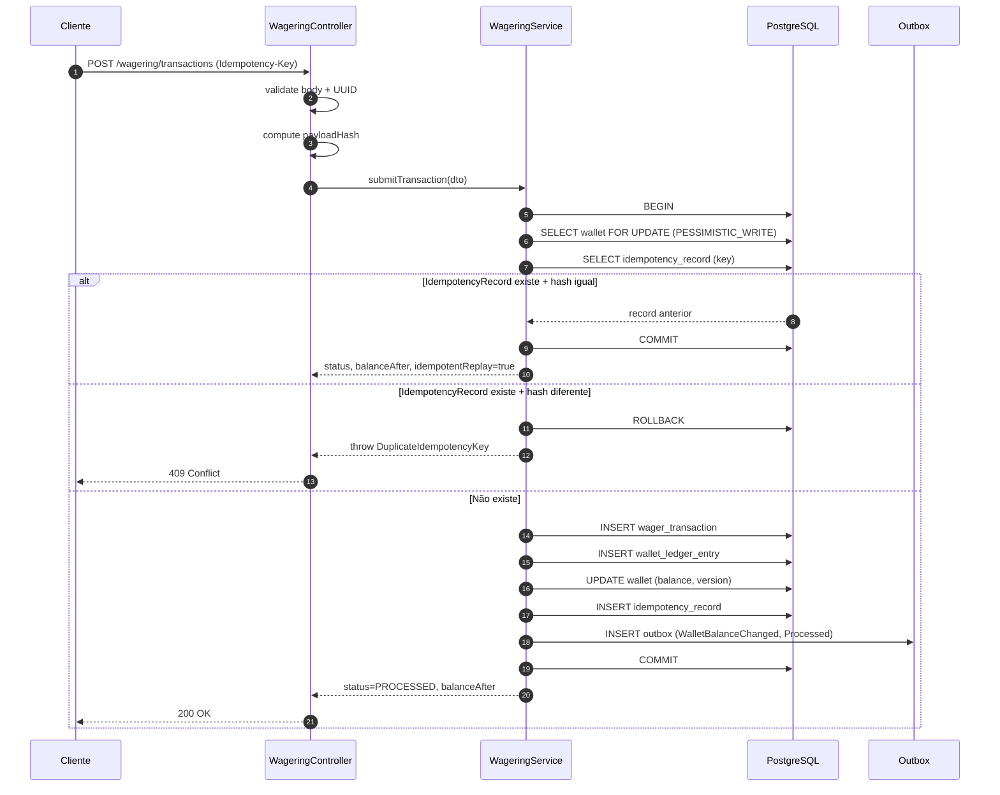
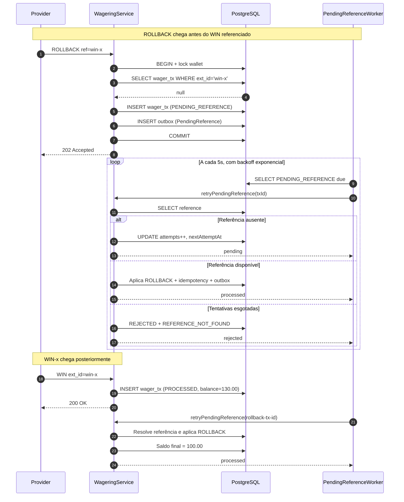
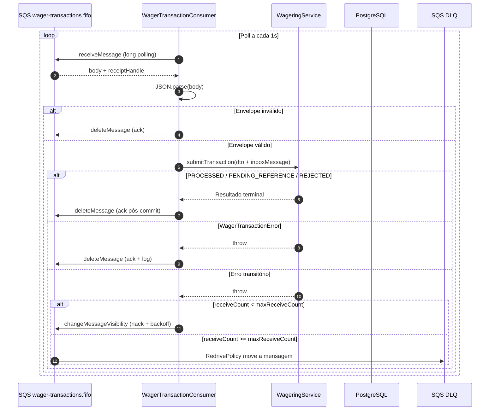

# ARCHITECTURE.md — Distributed Wagering Processor

## Índice

- [1. Objetivo](#1-objetivo)
- [2. Modelo de domínio](#2-modelo-de-domínio)
- [3. Persistência — MikroORM + PostgreSQL](#3-persistência--mikroorm--postgresql)
- [4. Concorrência — lock pessimista por wallet](#4-concorrência--lock-pessimista-por-wallet)
- [5. Idempotência](#5-idempotência)
- [6. Inbox / Outbox](#6-inbox--outbox)
- [7. Mensageria](#7-mensageria--provider-agnóstica)
- [8. `PENDING_REFERENCE`](#8-pending_reference--worker-com-backoff--ttl)
- [9. HTTP](#9-http--mapeamento-de-status-consistente)
- [10. Observabilidade](#10-observabilidade)
- [11. Decisões e trade-offs](#11-decisões-e-trade-offs)
- [12. Estratégia de testes](#12-estratégia-de-testes)
- [13. Limitações e funcionalidades não implementadas](#13-limitações-e-funcionalidades-não-implementadas)
- [14. Teste de carga](#14-load-test--metodologia-e-resultados)

---

## 1. Objetivo

Processar transações de apostas recebidas de múltiplos provedores com **correção financeira sob concorrência, idempotência persistente e consistência entre saldo materializado e ledger**.

O sistema permanece correto quando mensagens chegam duplicadas, fora de ordem ou simultaneamente, quando ocorre um crash entre commit e ack ou quando eventos são publicados mais de uma vez (spec, seção 3).

## 2. Modelo de domínio

- **Aggregate Root:** `Wallet`.
- **Value Object:** `Money` — imutável, string decimal, escala 2. Sem `number`, `float` ou `double` em nenhuma camada.
- **Entidades:** `WagerTransaction`, `WalletLedgerEntry` (imutável), `IdempotencyRecord`, `InboxMessage` e `OutboxMessage`.
- **Eventos de integração:** `IntegrationEvent<T>` abstrata, com subclasses concretas: `WagerTransactionProcessed`, `WalletBalanceChanged`, `WagerTransactionRejected` e `WagerTransactionPendingReference`. O payload serializa `MoneyProps` (string), nunca uma instância de `Money`.
- **Boundaries**: domínio com classes POJO puras (sem decorators, sem
`extends` de base ORM/NestJS) + camada de aplicação (`WageringService`)
+ infraestrutura (MikroORM, HTTP, SQS, workers). Os `EntitySchema` do
MikroORM coabitam os arquivos de entidade por coesão, mas são objetos
de mapeamento — as classes em si não dependem do ORM em runtime. Os
testes de integração exercitam o agregado real contra PostgreSQL.

### 2.1. Fluxos principais

#### Fluxo síncrono — `POST /wagering/transactions`

#### Fluxo `PENDING_REFERENCE` — referência fora de ordem

#### Fluxo de fila — SQS consumer

## 3. Persistência — MikroORM + PostgreSQL

### 3.1. Precisão monetária

As colunas monetárias utilizam `NUMERIC(18,2)` no banco, mapeadas para strings decimais em `Money`.

O `EntitySchema` declara `{ type: 'decimal', precision: 18, scale: 2 }` — sintaxe identificada como correta para MikroORM 6 no histórico de implementação. A forma `'decimal(18,2)'` cai no fallback `numeric(10,0)` e elimina a precisão dos centavos. O problema foi detectado com `schema:update --dump` e corrigido.

### 3.2. Schema como fonte de verdade

As garantias de integridade exigidas pela especificação são implementadas no banco, e não apenas no código:

- **Saldo não negativo:** `CHECK (balance_amount >= 0)` em `wallets`.
- **Ledger imutável:** o trigger `wallet_ledger_immutable_fn` bloqueia `UPDATE` e `DELETE` em `wallet_ledger_entries` (migration `Migration20260101000000`).
- **Wallet única por jogador e moeda:** `UNIQUE (player_id, currency)` em `wallets`.
- **Transação externa única:** `UNIQUE (provider_id, external_transaction_id)` em `wager_transactions`, necessário para resolver referências de `REFUND` e `ROLLBACK` de forma determinística.
- **Reversão única por referência e tipo:** o índice parcial `uq_wager_tx_reversal`, com `WHERE status='PROCESSED' AND reference_external_transaction_id IS NOT NULL`, impede que uma referência seja revertida duas vezes pelo mesmo `kind`. É uma proteção no banco, complementar à checagem em `resolveReferenceTx`.

### 3.3. Migrations versionadas

As migrations são versionadas e reversíveis.

**`schema:update` é proibido neste projeto.** O mecanismo de autodiff do MikroORM pode remover triggers e índices parciais que não são representados integralmente pelo ORM. Essa regra está documentada no README e no comando `db:verify`.

## 4. Concorrência — lock pessimista por wallet

- **Unidade de concorrência:** `walletId` (spec 8).
- **Estratégia:** `PESSIMISTIC_WRITE` (`SELECT ... FOR UPDATE`) em `submitTransaction`, dentro da transação SQL. Serializa operações sobre a mesma wallet e permite paralelismo entre wallets distintas. Não utiliza locks globais nem estratégia otimista com retries.
- **Ordem de persistência:** `wallets` é persistida em um `flush` isolado antes de `wager_transactions`. Sem isso, o MikroORM não infere a FK `wager_transactions.wallet_id → wallets.id`, pois a coluna é um UUID puro, sem `kind: 'm:1'`, podendo inserir na ordem errada e violar a constraint. A atomicidade é preservada porque ambos os `flush` ocorrem na mesma transação SQL.

### 4.1. Cenários de concorrência

Arquivo: `test/integration/concurrency/race-condition.integration.spec.ts`.

- Duas apostas de `80.00` disputando um saldo de `100.00` resultam em uma `PROCESSED` e uma `REJECTED`, saldo final de `20.00` e **um único débito** no ledger.
- A mesma aposta enviada 50 vezes resulta em um débito e 49 replays.
- Um rollback recebido antes da referência passa por `PENDING_REFERENCE` e é reprocessado quando a referência chega.
- Dois forks independentes disputam a mesma wallet em paralelo.

## 5. Idempotência — persistente e com fonte única de verdade

- **`IdempotencyRecord`:** persiste `(idempotencyKey, payloadHash, status, response)`. Mesma chave e mesmo hash resultam em replay fiel. Mesma chave com hash diferente resulta em `409 Conflict`.
- **`payloadHash`:** SHA-256 do JSON canônico, com chaves ordenadas, contendo o subconjunto de campos de negócio. Headers e metadados de transporte são excluídos.
- **Replay:** devolve `transactionId`, `status` e `balanceAfter` do momento original, sem recalcular (spec 7.7). Status `PENDING` é reprocessado, permitindo resolver `PENDING_REFERENCE` quando a referência chega.
- **Rejeições de negócio:** `INSUFFICIENT_FUNDS` e `REFERENCE_*` não lançam exceções. São persistidas como `REJECTED`, geram evento e retornam um resultado. Isso mantém a rejeição auditável e evita rollback do `IdempotencyRecord`.
- **Idempotência da abertura:** a criação de wallet grava um `IdempotencyRecord` com a chave `system:opening:{walletId}`. Uma reexecução da criação resulta em conflito.

## 6. Inbox / Outbox — limites transacionais

### 6.1. Inbox

A inbox utiliza `(messageId, consumerName)` para deduplicação persistente das mensagens da fila.

`submitTransaction` marca `processedAt` **na mesma transação SQL** em que a operação financeira é aplicada. Uma reentrega com o mesmo `messageId` resulta em replay sem novo débito, conforme validado por `scripts/test-queue.sh`.

### 6.2. Outbox

A transação financeira e os eventos de integração são gravados na **mesma transação SQL**.

O `OutboxPublisherWorker` publica os eventos usando `FOR UPDATE SKIP LOCKED` e atualiza `published_at`. Múltiplas instâncias podem drenar a outbox concorrentemente.

Uma duplicação eventual ainda pode ocorrer em caso de crash entre a publicação e o commit que registra a publicação. O consumidor deve absorver essa duplicação por meio da inbox.

### 6.3. Evento único na transição

O evento `WagerTransactionPendingReference` é enfileirado apenas na transição `PENDING → PENDING_REFERENCE`, e não a cada retry do worker. Esse comportamento foi ajustado após a identificação de um problema nos testes E2E.

## 7. Mensageria — provider-agnóstica

### 7.1. Adaptadores

A porta `QueueConsumerPort` possui duas implementações:

- `InMemoryQueueAdapter`: desenvolvimento e testes, selecionado por `QUEUE_BACKEND=memory`.
- `AwsSqsQueueAdapter`: LocalStack ou AWS, selecionado por `QUEUE_BACKEND=aws`.

O import de `@aws-sdk/client-sqs` é dinâmico. O pacote só é exigido quando o backend AWS é utilizado.

### 7.2. Consumer

O `WagerTransactionConsumer` reutiliza o mesmo caso de uso da entrada HTTP e distingue três situações:

- **Sucesso**, incluindo `REJECTED`: ack após o commit.
- **Erro de domínio** (`WagerTransactionError`): ack e log, pois repetir a mensagem não resolve a falha.
- **Erro transitório**, como indisponibilidade do banco ou timeout: nack com backoff e encaminhamento à DLQ após `SQS_MAX_RECEIVE_COUNT`.

### 7.3. Endpoints de desenvolvimento

Os endpoints abaixo permitem testar o consumer sem LocalStack:

- `POST /_dev/queue/publish`
- `GET /_dev/queue/stats`

Eles só ficam disponíveis quando `DEV_QUEUE_ENDPOINT=true`.

## 8. `PENDING_REFERENCE` — worker com backoff e TTL

- **Condição de entrada:** transações `REFUND` e `ROLLBACK` com referência ausente são registradas como `PENDING_REFERENCE` e geram um evento próprio.
- **Worker:** `PendingReferenceWorker` faz polling a cada 5 segundos. Para cada transação elegível, chama `retryPendingReference`, reutilizando `submitTransaction` e, consequentemente, a mesma idempotência e o mesmo lock.
- **Backoff:** exponencial com jitter, configurável por `PENDING_REFERENCE_BASE_BACKOFF_MS` e `PENDING_REFERENCE_MAX_BACKOFF_MS`.
- **TTL:** controlado por `PENDING_REFERENCE_MAX_ATTEMPTS`, com valor padrão 12. Ao esgotar as tentativas, a transação passa para `REJECTED`, com `failureCode=REFERENCE_NOT_FOUND`, e um evento é publicado (spec 7.1).
- **Idempotência do worker:** utiliza CAS sob `PESSIMISTIC_WRITE`, por meio de `pending_reference_attempts`. Se outra instância incrementar o contador durante o processamento, o incremento concorrente é abortado para evitar contabilização duplicada do retry.
- **Colunas dedicadas:** `pending_reference_attempts`, `pending_reference_next_attempt_at` e índice parcial `idx_wager_tx_pending_reference`, definidos na migration `Migration20260101000002`.

## 9. HTTP — mapeamento de status consistente

| Situação | HTTP | Corpo |
|---|---:|---|
| Payload inválido (shape, UUID ou moeda) | `400` | `{ error: 'INVALID_BODY', ... }` |
| Wallet ou transação não encontrada | `404` | `{ error: 'WALLET_NOT_FOUND', ... }` |
| `Idempotency-Key` reutilizada com payload divergente | `409` | `{ error: 'DUPLICATE_IDEMPOTENCY_KEY' }` |
| Rejeição de regra de negócio | `422` | `{ status: 'REJECTED', failureCode, ... }` |
| Aceita aguardando referência | `202` | `{ status: 'PENDING_REFERENCE', ... }` |
| Processado | `200` | `{ status: 'PROCESSED', balance, ... }` |
| Erro transitório de infraestrutura | `503` | `{ error: 'INFRA_*', retryable: true }` |

Rejeições de negócio são representadas por `422`, com um `failureCode` legível por máquina, em vez de serem mascaradas como erros genéricos (spec 7.2).

O header `Idempotency-Key` é obrigatório em `POST /wagering/transactions`.

Formato recomendado: `{providerId}:{externalTransactionId}`.

## 10. Observabilidade

### 10.1. Logs estruturados

Os logs são emitidos em JSON com os campos de correlação relevantes:

- `correlationId`
- `messageId`
- `transactionId`
- `walletId`
- `providerId`

O payload financeiro completo não é registrado nos logs.

### 10.2. Métricas Prometheus

As métricas são disponibilizadas em `GET /metrics`, utilizando `prom-client`.

| Métrica | Finalidade |
|---|---|
| `wager_transactions_total{status}` | Contagem de transações por status |
| `wager_submit_duration_seconds` | Latência do caso de uso |
| `wager_idempotency_replays_total` | Replays de idempotência |
| `wager_idempotency_conflicts_total` | Conflitos de idempotência |
| `wager_lock_conflicts_total` | Contenção de lock |
| `outbox_published_total` | Eventos publicados |
| `outbox_publish_failed_total` | Falhas de publicação |
| `outbox_pending` | Eventos pendentes na outbox |
| `outbox_event_age_seconds` | Idade dos eventos pendentes |
| `pending_reference_outcome_total{outcome}` | Resultados do processamento de referências pendentes |
| `queue_messages_received_total` | Mensagens recebidas |
| `queue_messages_acked_total{reason}` | Mensagens confirmadas |
| `queue_messages_nacked_total` | Mensagens rejeitadas temporariamente |
| `queue_messages_dlq_total` | Mensagens encaminhadas à DLQ |
| `http_errors_total{status}` | Erros HTTP por status |
| `nodejs_*` | Métricas padrão do `prom-client` para Node.js |

### 10.3. Health checks

- `/health/live`: verifica se o processo está vivo.
- `/health/ready`: verifica se PostgreSQL e SQS estão alcançáveis.

Nenhum dos endpoints exige autenticação.

## 11. Decisões e trade-offs

| Decisão | Justificativa | Trade-off |
|---|---|---|
| `Money` como Value Object com `Decimal` interno | Precisão exata, imutabilidade e ausência de vazamento do ORM | Mais verboso; cada operação cria uma nova instância |
| Lock pessimista em vez de otimista com retry | Serialização correta entre múltiplas instâncias; retries podem se esgotar | Contenção em wallets muito acessadas; reduzida pela curta duração do lock |
| Rejeição de negócio como resultado, não exceção | Rejeição auditável, replay fiel e preservação da idempotência | Camadas superiores devem verificar `result.status` |
| Outbox com `SKIP LOCKED` em vez de `LISTEN/NOTIFY` | Suporte a múltiplas instâncias sem complexidade de canais de notificação | Latência mínima de aproximadamente 1 segundo devido ao polling |
| Consumer independente do provider | Testável sem LocalStack e selecionável por variável de ambiente | Aproximadamente 150 linhas adicionais |
| Reuso de `submitTransaction` no consumer e no worker `PENDING_REFERENCE` | Uma única implementação da regra financeira | Custo de lock na wallet mesmo em retries que continuam pendentes |
| `schema:update` proibido | Evita a remoção de triggers e índices parciais não modelados pelo MikroORM | Migrations manuais para todas as mudanças de schema |
| `playerId` como UUID | Contrato da especificação, seção 9; `wager_transactions.player_id` é UUID | O validador aceita a forma canônica `8-4-4-4-12`, sem exigir uma versão específica |
| Métricas opcionais nos construtores | Permite testes de integração com `new WageringService(em)` sem NestJS | Parâmetro opcional (`?`) nos construtores |

## 12. Estratégia de testes

**Stack:** Bun test (runner), `@nestjs/testing` (injeção de dependências), `supertest` (HTTP) e PostgreSQL real.

### 12.1. Pirâmide de testes

| Nível | Comando | Tempo aproximado | Quantidade |
|---|---|---:|---:|
| Unit | `bun run test:unit` | ~150 ms | **88 testes** |
| Integration | `bun run test:integration` | ~7 s | **47 testes** |
| E2E | `bun run test:e2e` | ~2 s | **27 testes** |
| **Total** | `bun run test` | ~10 s | **162 testes** |

Os tempos são aproximados e dependem do ambiente.

### 12.2. Decisões de implementação

- **Unitários puros:** sem banco de dados e sem NestJS. Execução inferior a 200 ms no ambiente documentado, oferecendo feedback rápido para TDD.
- **Integração com PostgreSQL real:** sem mocks de banco. Utiliza `TRUNCATE CASCADE` no `beforeEach`.
- **E2E in-memory:** `Test.createTestingModule` e `supertest`. Inicializa o `AppModule` sem executar `start:dev`.
- **Serialização:** `--max-concurrency=1` é obrigatório nos testes de integração e E2E, pois eles compartilham o banco e operações `TRUNCATE` podem colidir quando executadas em paralelo.
- **Bun test:** runner nativo com compatibilidade com a API do Jest. Compatível com `@nestjs/testing@12`, que não depende de um runner específico.

### 12.3. Cobertura por especificação

| Spec | Cobertura documentada |
|---|---|
| 5 — Invariantes | 12 testes de schema e concorrência |
| 6 — Domínio | 88 testes unitários |
| 7 — Regras | 11 testes de integração e 5 E2E |
| 8 — Concorrência | 16 testes: 50 operações paralelas, múltiplas wallets, 3 forks e crash |
| 9 — HTTP | 16 testes E2E: `200`, `201`, `202`, `400`, `404`, `409` e `422` |
| 10 — SQS | 4 testes de integração SQS e 4 E2E do consumer |
| 11 — Outbox | 5 testes de integração com `SKIP LOCKED` e 3 E2E de eventos fora de ordem |
| 12 — Observabilidade | Teste E2E de `/metrics` |
| 13 — Testes | 8 de 8 cenários da especificação |

## 13. Limitações e funcionalidades não implementadas

- **Autenticação:** fora do escopo, conforme spec 2. `NoopAuthGuard` e `ProviderIdentityPort` são os pontos de extensão explícitos.
- **Traces OpenTelemetry:** não implementados; opcionais conforme spec 12.
- **Ledger double-entry:** não implementado; o ledger é single-entry por wallet. Trata-se de um diferencial opcional da spec 6.4.
- **Teste de carga (`test:load`):** entregue e executado. Existe uma limitação conhecida no parser da métrica Prometheus `wager_submit_duration_seconds`: o parser não interpreta corretamente o bucket `le="+Inf"` e pode reportar `p99: 0.0ms`. A limitação está no parser do relatório, não no sistema. Os resultados apresentados utilizam a p99 client-side.
- **DLQ no adaptador in-memory:** após `maxReceiveCount`, o adaptador move a mensagem para uma DLQ interna. No SQS real, a `RedrivePolicy` nativa, criada por `localstack-init.sh`, realiza o encaminhamento automaticamente. Ambos os fluxos possuem testes documentados:
  - `test/integration/queue/dlq.integration.spec.ts` — adaptador in-memory.
  - `test/integration/aws/sqs-real.integration.spec.ts` — SQS real.

## 14. Teste de carga — metodologia e resultados

O teste de carga é um diferencial opcional da spec 14 e está **entregue**. O comando `bun run test:load` executa dois cenários e reporta os resultados observados.

### 14.1. Ambiente

- **Aplicação:** executada in-process via `NestFactory.create`, sem servidor externo. Cada requisição passa pelo pipeline HTTP, pelo serviço de aplicação e pelo PostgreSQL real, sem mocks.
- **Banco de dados:** `wagering_db_test`, isolado e limpo com `TRUNCATE` no início.
- **Workers:** `WAGER_CONSUMER_ENABLED=false` e `PENDING_REFERENCE_WORKER_ENABLED=false`. Apenas o `OutboxPublisherWorker` permanece ativo para medir o lag real da outbox.
- **Hardware e software:** notebook do autor, Bun 1.4.0 e PostgreSQL 15 via Docker Compose, acessível pela porta `5433` do host. Não houve isolamento de CPU ou RAM.

### 14.2. Metodologia

Dois cenários, com 1.000 requisições por cenário por padrão.

| Cenário | Configuração | Objetivo |
|---|---|---|
| A — Contenção | 1 wallet × 1.000 apostas `BET` paralelas de R$ 1 | Medir a contenção em uma hot wallet |
| B — Throughput | 100 wallets × 10 apostas cada, executadas em paralelo | Medir o throughput com paralelismo entre wallets |

Parâmetros e coleta:

- **Concorrência:** `LOAD_CONCURRENCY=100`, com até 100 requisições simultâneas por meio de `Promise.allSettled`, em batches de 100.
- **Amostras:** cada requisição registra `performance.now()` antes e depois do `fetch`. Os percentis são calculados sobre a amostra completa, não sobre buckets do histograma.
- **Erros:** respostas 2xx são consideradas sucesso; `422` representa rejeição de negócio esperada; erros 5xx ou de rede fazem o teste falhar.
- **Outbox:** o teste aguarda a drenagem por até 30 segundos. Falha somente se a drenagem não ocorrer; o tempo observado também é reportado.

### 14.3. Resultados reais — execução de 2026-10-19

#### Cenário A — contenção: 1 wallet × 1.000 apostas

| Métrica | Resultado |
|---|---:|
| Duração total (wall time) | 8,163 s |
| Throughput | **122,5 req/s** |
| p50 | **415 ms** |
| p95 | **1.023 ms** |
| p99 | **1.359 ms** |
| Erros | 0 |
| `lock_conflicts` | 0 |
| Tempo para drenar a outbox | ~14 s |
| Banco | 1.001 `PROCESSED` |

#### Cenário B — throughput: 100 wallets × 10 apostas

| Métrica | Resultado |
|---|---:|
| Duração total (wall time) | 4,306 s |
| Throughput | **232,2 req/s** |
| p50 | **224 ms** |
| p95 | **413 ms** |
| p99 | **471 ms** |
| Erros | 0 |
| `lock_conflicts` | 0 |
| Tempo para drenar a outbox | ~9 s |
| Banco | 2.101 `PROCESSED` |

### 14.4. Análise dos resultados

#### Contenção versus throughput

O cenário A apresenta throughput aproximadamente **1,9× menor** que o cenário B e p50 aproximadamente **1,9× maior**. Isso confirma que a hot wallet tem impacto relevante, mas não é o único gargalo.

#### Gargalos observados e hipóteses

O valor `lock_conflicts = 0` é consistente com a serialização das operações pelo `PESSIMISTIC_WRITE`, sem conflitos contabilizados pela métrica. Isoladamente, porém, esse contador não prova a ausência de deadlocks nem identifica o gargalo de throughput.

Os principais fatores considerados são:

1. **Pool de conexões do banco:** o pool padrão do MikroORM pode operar com aproximadamente 10–20 conexões. Com 100 requisições simultâneas, parte delas pode aguardar uma conexão disponível.
2. **Overhead do pipeline:** NestJS, Express, validação, domínio, MikroORM e `fetch` contribuem para a latência total.
3. **Commit síncrono do PostgreSQL:** cada `submitTransaction` executa `BEGIN`, `SELECT FOR UPDATE`, inserções, atualização e `COMMIT`. O custo depende da configuração e do ambiente de armazenamento.
4. **Eventos de outbox:** cada requisição pode produzir dois eventos, `WalletBalanceChanged` e `WagerTransactionProcessed`. Sob carga, o publicador pode ficar temporariamente atrás do processamento, exigindo aproximadamente 9–14 segundos para drenar a outbox após o pico.

#### Latência de cauda

Os valores elevados de p95 e p99 no cenário A são compatíveis com a serialização de operações sobre uma mesma wallet. Requisições concorrentes precisam aguardar a liberação do lock.

Uma implementação otimista com retries apresentaria outro perfil de latência, mas poderia sofrer com retries repetidos ou starvation sob contenção elevada. A comparação exigiria um experimento equivalente.

#### Possíveis melhorias de escalabilidade

- PgBouncer e dimensionamento do pool de conexões de acordo com a concorrência desejada.
- Múltiplas instâncias da aplicação.
- Particionamento ou sharding por `walletId`, quando adequado à arquitetura e às garantias de consistência necessárias.

Essas mudanças podem melhorar a capacidade de processamento, mas precisam preservar a invariante financeira e ser validadas por novos testes.

### 14.5. Limitações do experimento

- **Máquina única:** não mede latência de rede entre a aplicação e o banco.
- **Variabilidade entre execuções:** sem isolamento de CPU, as medições podem variar aproximadamente ±20%.
- **Docker versus execução nativa:** foi observada uma diferença aproximada de 2× entre ambientes. Sem condições idênticas, os resultados não são diretamente comparáveis.
- **Sem ramp-up:** as 100 requisições concorrentes de cada batch são iniciadas sem uma fase gradual de aquecimento.
- **Sem teste de caos:** não são simuladas falhas de PostgreSQL ou SQS durante a execução.
- **Amostra única:** os resultados representam uma execução, sem intervalo de confiança.
- **Histograma Prometheus:** o parser pode retornar o limite do bucket (`2.5s`) em vez da p99 real. Por isso, o relatório utiliza a p99 client-side e não usa o valor do histograma como percentil exato. A métrica `outbox_event_age_seconds` fornece informação sobre a idade dos eventos na outbox.

### 14.6. Como tornar o teste mais rigoroso

Um experimento futuro poderia incluir:

- `k6` ou `vegeta`, com ramp-up, duração fixa e warmup explícito.
- Aplicação e banco de dados em hosts distintos.
- PgBouncer e pool dimensionado para a concorrência-alvo.
- Hooks de injeção de falhas durante a execução.
- Múltiplas repetições, com mediana, dispersão e intervalos de confiança.
